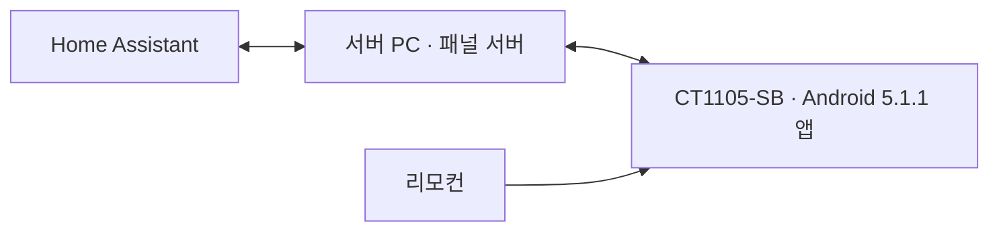

# KT_TABLE_TV · 홈 패널

KT 기가지니 테이블 TV **CT1105-SB**를 **macOS·Linux·Windows(WSL2) + Home Assistant**의 리모컨 조작용 화면으로 사용하는 프로젝트입니다. Android 5.1.1용 앱, 서버, 운영체제별 설치 도우미와 한국어 매뉴얼을 제공합니다.

**처음 설치한다면 운영체제에 맞는 매뉴얼부터 읽어 주세요.**

| 서버 환경 | 실행 방식 | 안내 |
| --- | --- | --- |
| macOS · Intel / Apple Silicon | 기존 `.command` 도우미 | [Mac 설치](docs/INSTALL_KO.md) |
| Linux · Ubuntu x86_64 | `.sh` 도우미, 선택적 systemd 사용자 서비스 | [Linux 설치](docs/LINUX_KO.md) |
| Windows 11 x64 · WSL2 Ubuntu x86_64 | WSL 미러 네트워크 + Linux 실행, PowerShell 도우미 | [Windows 설치](docs/WINDOWS_KO.md) |

Windows는 WSL2 환경에서 실행합니다. Windows 네이티브 서버, Windows 10/WSL1, Linux ARM64 Android 빌드는 지원 범위에 포함하지 않습니다.

## 사용할 수 있는 기능

- Home Assistant 계정 연결과 사용자 집의 방·센서·장면 설정
- 온도·습도·CO₂, 환경 이력, 날씨와 시간별 예보 표시
- 등록한 에어컨 켜기·끄기 장면 실행, 세탁기 상태와 패널 내 완료 알림
- 검정 계열 화면, 방향키·확인·뒤로 조작, 검은 시계 대기 화면
- 최초 USB 설치 후 기본 홈·자동 시작 설정, 서명 검증을 거치는 원격 앱 업데이트
- 정상 동작을 확인한 앱 보관과 복구용 버전 준비

기기별 엔티티와 예보·이력 제공 여부는 Home Assistant 통합에 따라 다릅니다. 현재 설정 도우미는 이름을 직접 정하는 **두 개의 방**과 선택 사항인 **네 개의 HA 장면**을 지원합니다. 제조사 계정은 HA에서 연결합니다.

## 문서

| 문서 | 내용 |
| --- | --- |
| [Mac·공통 기기 설치](docs/INSTALL_KO.md) | Mac 설정, 앱 빌드, USB 설치, 자동 시작 |
| [Linux 설치](docs/LINUX_KO.md) | Ubuntu 도구, 서버·앱 빌드, systemd |
| [Windows 설치](docs/WINDOWS_KO.md) | WSL2, LAN 연결, PowerShell 도우미 |
| [Home Assistant 연결](docs/HOME_ASSISTANT_KO.md) | HA 설치, SmartThings·Tuya·Sonoff·LG ThinQ, 방·센서 지정 |
| [업데이트와 문제 해결](docs/OPERATIONS_KO.md) | 실행 상태, 원격 업데이트, 기본 홈 복원, 복구 |
| [개인정보와 재배포](docs/PRIVACY_KO.md) | 공개하면 안 되는 파일과 검사 방법 |
| [외부 구성요소](THIRD_PARTY_NOTICES.md) | 사용 도구·통합의 출처와 서명 설명 |

## 지원 범위와 검증

단말 대상은 CT1105-SB의 Android 5.1.1 / SDK 22 환경입니다. 서버 환경은 위 지원 표를 따릅니다. 기준 기기의 하드웨어 표기는 `bigfish`, 커널 표기는 `3.18.24_hi3798cv2x`였습니다. 다른 KT 모델·보드·펌웨어까지 호환된다고 보장하지 않습니다.

기존 개인 설치에서는 USB 없는 부팅, 원격 업데이트, 대기 화면과 리모컨 복귀를 확인했습니다. 이 공개판은 개인 설정을 제거하고 별도 패키지 `dev.homepanel.community`로 분리했습니다. 새로운 임시 설정에서 Android 빌드·서명 검사, HA 모의 연결과 단위 테스트를 수행합니다. GitHub Actions에는 Linux·macOS 테스트, Linux Android 빌드, Windows PowerShell 구문·입력 검사도 포함됩니다. WSL의 실제 LAN 통신과 **제3자의 새 기기 전체 설치는 현장 확인이 필요합니다.**

LineageOS 이미지나 순정 펌웨어를 배포하는 저장소가 아닙니다. 설치 과정에는 앱 설치와 기본 홈 변경이 포함되며 기존 홈 복원 메뉴를 제공합니다. USB 자동 설치 경로와 기기 서비스가 다른 펌웨어에서는 설치가 진행되지 않을 수 있습니다.

## 소스 배포

이 저장소에는 개인 IP·계정·토큰·서명 개인키·기기 덤프·제조사 APK를 포함하지 않습니다. 설치 시 각 사용자의 설정과 키를 새로 만듭니다. 생성된 앱에는 해당 설치자의 연결정보가 들어가므로 **APK와 `runtime/`를 다른 사람에게 전달하지 마세요.** 각자 이 소스로 빌드합니다.

소스는 [MIT 라이선스](LICENSE)입니다. KT·Home Assistant의 공식 제품 또는 공식 지원 도구가 아닙니다.
